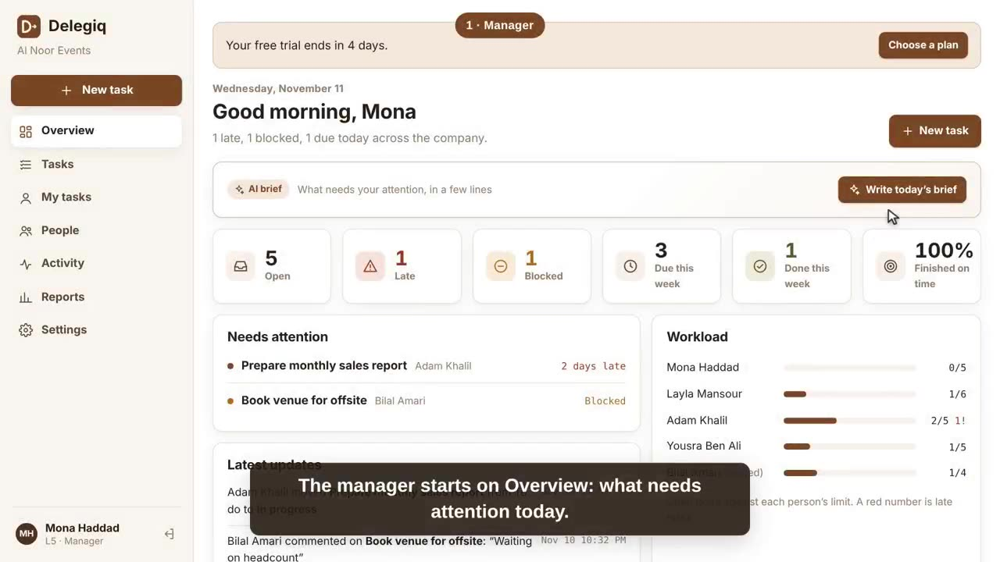

# Delegiq

**Hand out work, track deadlines, and get told when something slips.**

**Try it:** https://karawene112.github.io/handoff/ · **Open the app:** https://karawene112.github.io/handoff/app/

[](docs/media/delegiq-demo.mp4)

▶ [Watch the 90-second tour](docs/media/delegiq-demo.mp4)

Delegiq is a web app for teams: managers hand out tasks (AI writes them from one sentence or a voice note), everyone sees only what their level allows, and reminders go out by email and WhatsApp before and after deadlines. It works in English, French and Arabic, on desktop and phone, and is sold as a monthly subscription with a 14-day free trial.

**Built with:** plain HTML, CSS and JavaScript · Supabase (Postgres with row-level security, Auth with two-step sign-in, Edge Functions, Storage, cron) · Claude API · Resend · WhatsApp Cloud API · Lemon Squeezy · GitHub Pages.

Everyone has a **level** (1 to 5) and a set of **numbered rights**. People can only manage others in **their own team** at a **lower level**, unless they have right 9.

| Right | What it allows |
| --- | --- |
| 1 | See and update my own tasks (everyone has this) |
| 2 | See the tasks of people below me in my team |
| 3 | Create tasks and give them to people below me |
| 4 | Edit and reassign those tasks |
| 5 | Delete those tasks |
| 6 | See activity and reports for people below me |
| 7 | Add people below me and send them logins |
| 8 | Change the level and rights of people below me |
| 9 | See and manage everyone, in every team |
| 10 | Change company settings and the level list |

| Level | Name (you can rename) | Rights to start with |
| --- | --- | --- |
| 1 | Team member | 1 |
| 2 | Senior member | 1, 2, 6 |
| 3 | Team leader | 1, 2, 3, 4, 6, 7 |
| 4 | Department head | 1–8 |
| 5 | Manager | 1–10 |

Change a level's name or rights in **Settings → Levels**: everyone at that level follows. To give one person different rights, open **People → Edit**, untick "Use the rights of their level" and pick the numbers. Nobody can give a level or right higher than their own, and the company always keeps at least one person with right 10.

Late, blocked and progress emails go to whoever is in charge of that person: people above them in their team with right 2, and everyone with right 9.

The database enforces who sees what, so a team member can't see someone else's work even by poking at the website.

## What's where

| Folder | What it is |
| --- | --- |
| `docs/` | The sales page (`index.html`), Terms, Privacy and Refunds pages, and the demo video. |
| `docs/app/` | The app itself. Plain HTML, CSS and JavaScript, no build step. |
| `supabase/functions/billing/` | Receives payment events from Lemon Squeezy and switches each company's plan on or off. Already deployed. |
| `supabase/functions/notify/` | The email sender. Already deployed to your Supabase project. |
| `supabase/functions/ai/` | The AI: drafts a task from one sentence and writes the daily brief, using Claude. Already deployed. |
| `supabase/functions/add-member/` | Creates a team member's login with a temporary password (managers only). Already deployed. |

The database (tables, access rules, triggers, reminder schedule) is already set up in the Supabase project **handoff**. You can see the history under Database → Migrations in the Supabase dashboard.

## Emails it sends

| When | Who |
| --- | --- |
| Added to the team, or given a new password | The person: their email and a temporary password |
| Task assigned or handed over | The person it's for |
| 2 days before the deadline, and on the day | The person it's for |
| Deadline passed | The person **and** their manager / team lead |
| Still late after N days (you choose N in Settings) | Manager and team lead again |
| Status changes (started, blocked, done) | Manager and team lead; blocked is marked urgent |
| Deadline moved, or someone comments | The other person on the task |
| Every morning at 8:00 | Managers and team leads: late, due today, blocked, workload |
| Every Monday | Managers and team leads: last week per person |

People can switch to "one summary each morning" in Settings. Late, blocked and invite emails always go out right away.

## Setting it up (about 20 minutes, once)

### 1. Put the website online

**GitHub Pages:** in this repository, open Settings → Pages. Under "Build and deployment" pick **Deploy from a branch**, branch **main**, folder **/docs**, then Save. After a minute the sales page is at `https://<your-username>.github.io/handoff/` and the app at `https://<your-username>.github.io/handoff/app/`.

**Or Vercel:** New Project → import this repository → set **Root Directory** to `docs` → Framework preset **Other** → Deploy.

### 2. Tell Supabase where the website lives

In the Supabase dashboard for **handoff**, open Authentication → URL Configuration:

- **Site URL:** the app's address, for example `https://karawene112.github.io/handoff/app/`
- **Redirect URLs:** add the same address.

Then run this in the SQL editor, keeping the `/#` at the end. Email links use it, and the add-person function only accepts requests from this address, so adding people won't work until it's set:

```sql
update public.app_settings set value = 'https://karawene112.github.io/handoff/app/#' where key = 'app_url';
```

### 3. Connect the email service (Resend)

1. Create a free account at resend.com and make an API key.
2. In Supabase, open Edge Functions → Secrets and add `RESEND_API_KEY` with that key.
3. **To email your team, verify a domain** in Resend (Domains → Add domain, then add the DNS records it shows). Until you do, Resend only delivers to your own address. Once verified, set the sender:

```sql
update public.app_settings set value = 'Delegiq <tasks@yourdomain.com>' where key = 'email_from';
```

4. Recommended: in Supabase → Authentication → Emails → SMTP Settings, turn on custom SMTP with host `smtp.resend.com`, port `465`, username `resend`, password = your Resend API key, and your verified sender. Supabase's built-in sender only allows a few sign-up and password emails per hour.

### 4. Switch on the AI

Delegiq's AI (writing tasks from one sentence, and the daily brief) uses Claude.

1. Create an API key at console.anthropic.com (Settings → API keys) and add some credit.
2. In Supabase, open Edge Functions → Secrets and add `ANTHROPIC_API_KEY` with that key.

The AI only reads what the signed-in person is allowed to see, and each person can use it up to 60 times an hour. Without the key, everything else works and the AI buttons explain that AI isn't switched on yet.

### 5. Start using it

1. Open the website, create your account, and confirm your email.
2. Name your team. You're now its manager.
3. Under **People**, add each person. Delegiq creates their login, emails them a temporary password, and shows it to you once so you can also send it by WhatsApp. The first time they sign in, they choose their own password. If someone forgets theirs, use **Send new password** on the People page.
4. Create tasks from **Overview** or **Tasks**.

### Optional: Google sign-in

Turn on Google in Supabase → Authentication → Providers, then set `googleSignIn: true` in `docs/config.js`.

## Selling Delegiq

Any company can sign up from the sales page and gets a **free 14-day trial for up to 30 people**. After that they need a plan:

| Plan | Price | People |
| --- | --- | --- |
| Starter | $19/month | 10 |
| Team | $49/month | 30 |
| Business | $99/month | 100 |

When a trial ends or a payment stops, the company can still see and update its work but can't add tasks or people. The database enforces this and the people limit. Each person can create at most 3 companies.

Payments go through **Lemon Squeezy**, which supports sellers in Qatar, pays out to a Qatari bank, and handles sales tax and invoices worldwide as the merchant of record.

### Connect Lemon Squeezy (about 30 minutes)

1. Create a store at lemonsqueezy.com and complete identity verification and payout details. Use the sales page, `terms.html`, `privacy.html` and `refunds.html` as your website and policies.
2. Create one product, **Delegiq**, as a subscription with three variants: Starter $19/month, Team $49/month, Business $99/month. Don't add a trial in Lemon Squeezy; the app already gives one.
3. For each variant, copy its **checkout link** and its **variant ID**, then run:

```sql
update public.plans set checkout_url = 'https://YOURSTORE.lemonsqueezy.com/buy/…', ls_variant_id = 123456 where id = 'starter';
-- same for 'team' and 'business'
```

4. In Lemon Squeezy → Settings → Webhooks, add a webhook:
   - URL: `https://ctnetlnnticvwkvxmmws.supabase.co/functions/v1/billing`
   - Signing secret: a long random password you make up
   - Events: every `subscription_…` event
5. In Supabase → Edge Functions → Secrets, add `LEMONSQUEEZY_WEBHOOK_SECRET` with the same signing secret.
6. In Lemon Squeezy's customer portal settings, allow customers to change plans, so upgrades and downgrades happen there.
7. Test with Lemon Squeezy's test mode and test card before switching the store live.

### Your own company, free

```sql
update public.subscriptions set status = 'comp', plan = 'comp', seat_limit = 1000
where workspace_id = (select id from public.workspaces where name = 'YOUR COMPANY NAME');
```

### Contact email on the public pages

Set `SUPPORT_EMAIL` at the top of `docs/site.js`. While it is empty, contact links are hidden.

## Languages, templates, voice notes and WhatsApp

- **Languages:** English, French and Arabic. Each person picks theirs on the sign-in page or in Settings → Language. Arabic turns the whole layout right to left, and the AI writes tasks and the daily brief in the chosen language. All wording lives in `docs/app/i18n-words.js` (English → French, Arabic); edit a phrase there to change it. Emails are still in English for now.
- **Task templates:** on New task, fill in a task and press **Save as template**. Next time, pick it from **Start from a template**. Managers and team leaders (right 3) can use them; delete them in Settings → Task templates.
- **Voice note → task:** on New task, press **Speak**, say who, what and by when, then **Write it for me**. The browser turns speech into text (Chrome, Edge and Safari; the button is hidden where it isn't supported). In Chrome the audio is processed by Google's speech service.
- **WhatsApp reminders:** each person adds their number in Settings → WhatsApp reminders and ticks the box. New tasks, deadline reminders, late tasks, moved deadlines and blocked tasks are then also sent on WhatsApp. Included in the free trial, Team and Business.

### Switch on WhatsApp (needs a Meta business account)

1. In Meta Business Suite, create (or use) your business and verify it.
2. At developers.facebook.com create an app of type **Business**, add the **WhatsApp** product, and add a phone number that isn't already used in the WhatsApp app.
3. In WhatsApp Manager create a message template named **`delegiq_alert`**, category **Utility**, in English (`en`), French (`fr`) and Arabic (`ar`), with this body (translated for each language):

   ```
   {{1}}

   {{2}}

   Open Delegiq: {{3}}
   ```
   `{{1}}` is the headline (for example "New task: Prepare the Q4 report"), `{{2}}` one line of detail, `{{3}}` the link. Wait for Meta to approve it.
4. Create a permanent access token for a system user with the `whatsapp_business_messaging` permission.
5. In Supabase → Edge Functions → Secrets add `WHATSAPP_TOKEN` (the token) and `WHATSAPP_PHONE_ID` (the phone number ID shown in the WhatsApp settings of your app).

Meta charges a small fee per message, depending on the country. Messages go out within 2 minutes. Problems are written to the `wa_error` column of the `notifications` table.

## Security

**Built in**
- **Two-step sign-in (authenticator app)** is required for anyone with rights 7, 8, 9 or 10. Until they enter their code, the database gives them no access at all. Anyone else can turn it on in Settings.
- **Automatic sign-out** after 30 minutes without activity (change `idleMinutes` in `docs/config.js`), and **Sign out everywhere** in Settings.
- **Sign-in history:** everyone sees their own recent sign-ins; people who manage others see each person's last sign-in, device and whether two-step is on (People page).
- **Closed sign-up:** only the very first person can create a company. After that, accounts are only made through "Add someone".
- **Access rules in the database** for every table and file, based on level and rights.
- **Only safe file types** can be attached (PDF, images, Word, Excel, PowerPoint, CSV, text), up to 20 MB, behind links that expire after an hour.
- **Content Security Policy:** the website can only load its own code and the pinned Supabase library, and can only talk to your Supabase project.
- **The add-person function only answers your website** (it reads the address from `app_url`), and only for sessions that passed two-step sign-in.
- Temporary passwords are wiped from stored emails once sent. Every change is in the activity log.

**Switch on yourself (Supabase dashboard)**
- Authentication → Sign In / Providers → Email: turn **off "Allow new users to sign up"** once your own account exists. (Adding people still works.)
- Authentication → Passwords: minimum length **10+**, require letters and digits, and turn on **leaked password protection** (may need a paid plan).
- Authentication → Multi-Factor: make sure **TOTP (authenticator app)** is enabled.
- Your own Supabase and GitHub accounts: turn on **two-factor**.
- Database → Backups: a paid plan adds daily backups; point-in-time recovery is an add-on.
- **Lost phone?** In Supabase → Authentication → Users, open the person and remove their MFA factor. They set it up again at next sign-in.

## On phones

Open the website and use **Share → Add to Home Screen** (iPhone) or **Install app** (Android). It opens like an app.

## Good to know

- Temporary passwords are wiped from the server's copy of the email as soon as it's sent.
- `docs/config.js` holds the Supabase address and the *publishable* key. Both are meant to be public; the access rules do the protecting.
- A workspace always keeps at least one manager, so you can't lock yourself out.
- Removing a person takes away their access at once and unassigns their open tasks. Their history stays.
